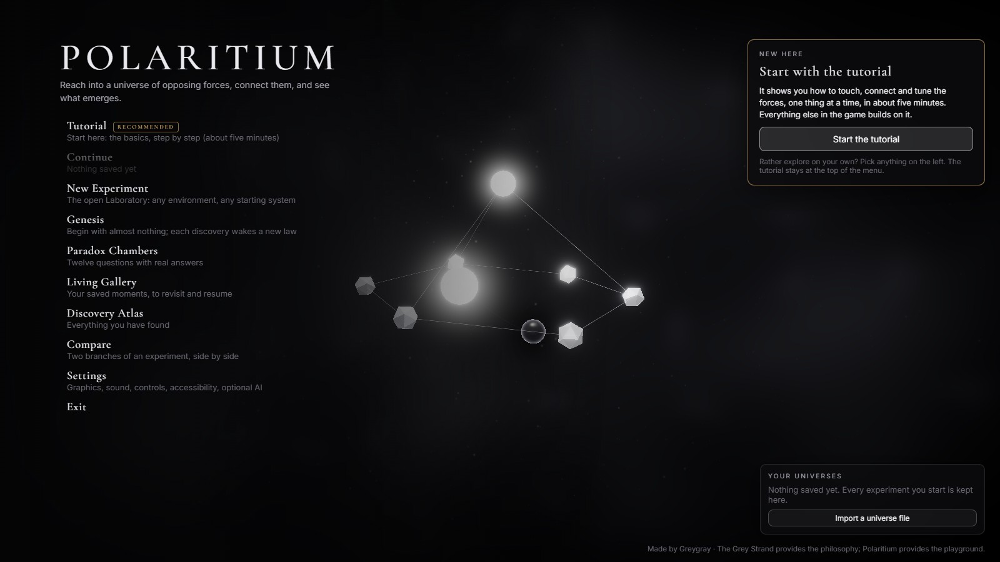
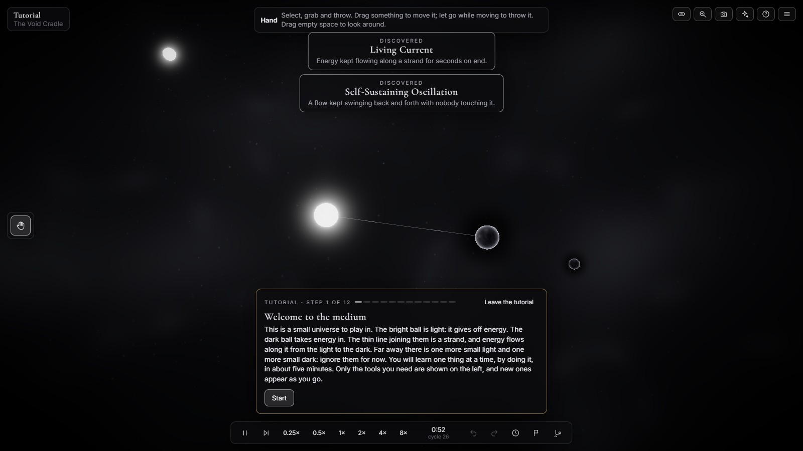
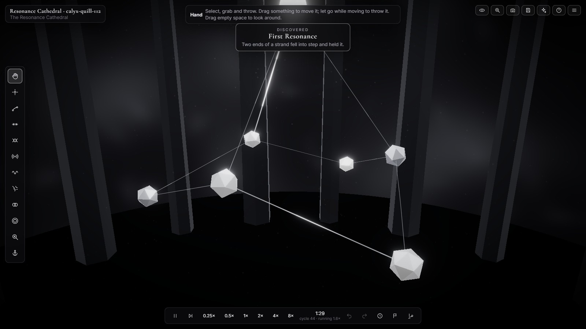
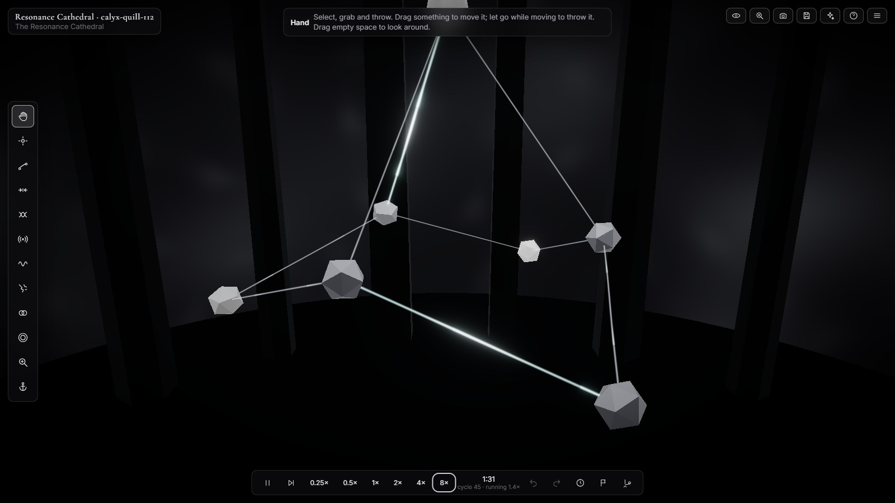
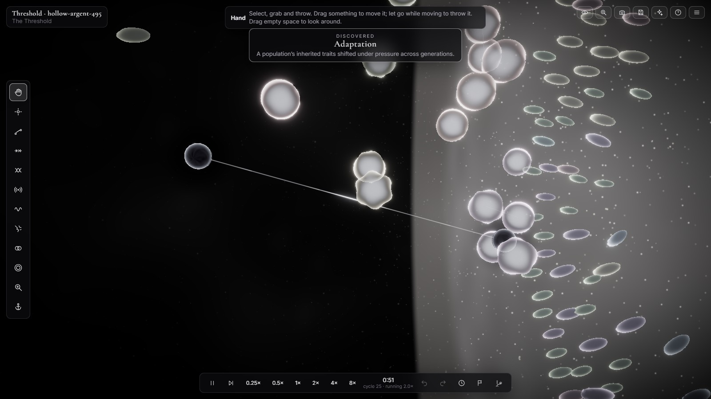
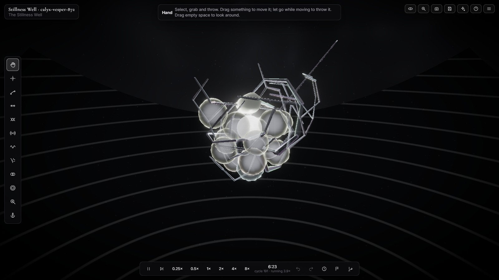
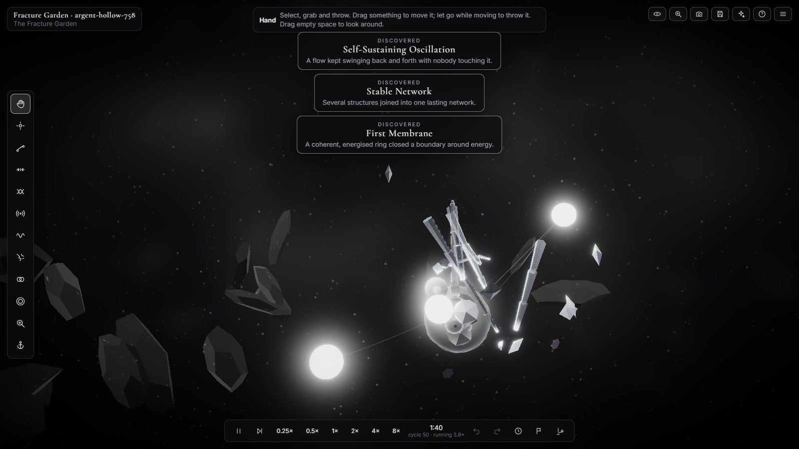
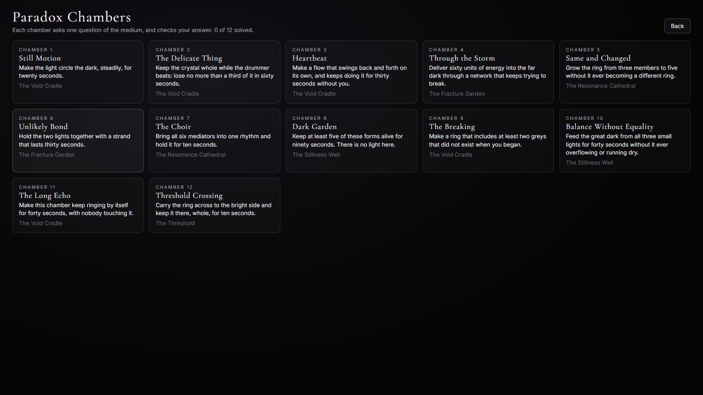
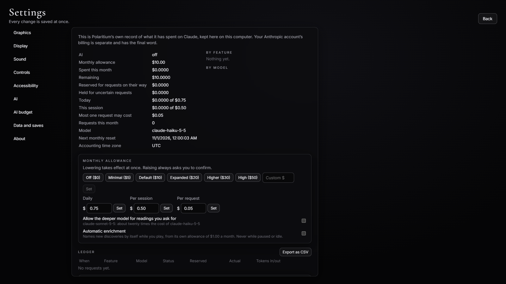

# Polaritium

### A universe of opposing forces you can touch.

Polaritium is a 3D game for Windows. Its universe is made of one strange, made-up medium that shows itself three ways: **light**, which gives energy out, **dark**, which draws energy in and holds it, and **grey**, which sits between things and passes energy, rhythm and change from one to the other. None of them is good or bad.

You reach in and touch them. Connect a light to a dark and energy flows along the strand. Tune two things to nearby rhythms and they fall into step. Push a strand too hard and it snaps. Nothing is scripted: rings, membranes, crystals and small living forms appear only when the conditions allow them, and then they keep going on their own.

The whole game asks one question: *what happens if I try this?*

## Start here: the tutorial

A new player is offered a five-minute tutorial before anything else. It teaches one idea at a time in a small practice universe: look around, touch the light, move it, see the connections, tune a rhythm, send a wave, stop time, make something new, connect it, and let it run. Each step hands over only the tool it needs, circles its button, waits for the player to really do it, shows a tick when it worked, and waits for them to click Next. If a step takes a while, it offers an easier way and a way past. It can be left at any point and played again later.

## What you can do

- **Build and break relationships.** Strands carry flow. More coupling carries more, until the flow starts to ring back and forth; too much and the strand breaks.
- **Watch things emerge.** A strand ringing in step can give birth to grey. A closed loop in step becomes a ring with its own identity, a strong ring can grow a membrane, and a full dark collapses and throws its energy out.
- **Grow crystals.** In stillness and light they grow along their own lattice. Shake one at its own frequency and it breaks.
- **Raise life.** Small forms feed on light or dark, swim, flash, bond, divide with small changes, go dormant and die. Over generations a population changes in answer to what you do to it.
- **Hold time in your hand.** Pause, step one moment, run from a quarter speed to eight times. Undo puts the universe back exactly as it was. Rewind, make checkpoints, and turn any checkpoint into a branch that goes its own way.
- **See what is hidden.** Strand Sight quiets everything except the web of connections. The Lens shows pooled light, passing vibration and the pull on each thing.
- **Keep what you find.** Each new kind of event goes into the Discovery Atlas with a picture, its measurements and what caused it, and the Atlas records only what really happened. The Living Gallery keeps moments you liked, Compare runs two experiments side by side, and any universe can be saved to a file and handed to someone else.

## The twelve tools

Every tool sits on the rail at the left and has its own key. Each one also works without dragging, from the keyboard.

| Key | Tool | What it does |
|---|---|---|
| 1 | Hand | Select, grab and throw. |
| 2 | Seed | Place new light, dark, grey, a crystal seed or a living form. |
| 3 | Strand | Connect two things so energy can flow between them. |
| 4 | Pull | Draw things toward a point (or push them away), or shorten and lengthen a strand. |
| 5 | Twist | Twist a strand. A twisted strand carrying flow turns its ends around each other. |
| 6 | Pulse | Send a wave through the medium. Hold longer for a stronger one. |
| 7 | Tune | Change something's rhythm, which you can hear, or how tightly a strand couples. |
| 8 | Fracture | Cut a strand, or shake something until it may break. |
| 9 | Fuse | Merge two things into one. |
| 0 | Veil | Place a shield that keeps its inside apart from the outside. |
| L | Lens | Show the invisible: pooled light, passing vibration, the pull on each thing. |
| K | Anchor | Hold something in place, or hold its rhythm or its energy. |

## The places

- **The Void Cradle.** A sparse dark where even weak attractions show.
- **The Resonance Cathedral.** Mirrored walls; every vibration comes back to you.
- **The Fracture Garden.** Everything breaks easily, and what breaks grows back.
- **The Stillness Well.** A heavy calm where small disturbances last a long time.
- **The Threshold.** A bright half, a dark half, and a moving edge where things change.
- **Genesis, the First Dark.** Almost nothing at first. The deeper laws wake only as you find them.

Each place can start empty or with one of seven starting systems, from a single light and dark to a shoal of living forms or a dark that is nearly full.

## Twelve Paradox Chambers

Twelve puzzles, each a question with more than one answer: make the light circle the dark, keep a crystal whole while the drummer beats, bring six mediators into one rhythm, carry a ring across the Threshold. A chamber checks its goal from the simulation itself, so any way that truly works counts. The first unsolved one is marked *Start here*, each chamber lists the tools it uses, and its Hint button offers a nudge when nothing has moved for a while.

## Optional AI, with a hard limit

The whole game works without AI, and AI is off until you switch it on. If you add your own Claude key, the game can interpret an experiment, suggest things to try, name discoveries and write captions for pictures, and it only sends a request when you press a button for one.

- **It never spends more than you allow.** The default limit is **$10 a month**, with $0.75 a day, $0.50 a session and at most $0.05 for one request. Lowering a limit works at once; raising one always asks you to confirm.
- **Checked before it is sent.** The game works out the most a request could possibly cost and sets that aside first. If that would cross any limit, nothing is sent.
- **Your key stays yours.** It is stored encrypted by Windows, never shown again, and never written into saves, exports, pictures or logs.
- **The everyday model is Claude Haiku**, where a typical request costs well under a tenth of a cent. The deeper model is used only for readings you ask for, and only after you allow it.

Every AI path is tested against a pretend Claude. No paid request has been made yet, so the first real one will be the first live check.

## System needs

- Windows 10 or 11, 64-bit. The installer is 115 MB.
- Works offline, with no account. AI is the only part that uses the internet, and only when you ask.
- Tested on a laptop with Intel UHD integrated graphics (Core i3, 16 GB), where every graphics level, Low to Ultra, held its frame limit. Older or weaker graphics may need Low.
- **The installer is not code-signed.** Windows SmartScreen warns the first time it runs ("Windows protected your PC"); choose **More info**, then **Run anyway**.

## Where it stands

Version 1.2.1, 26 October 2026: the tutorial waits for you and circles the button each step is about, the first puzzle explains how it is really solved, and six calm, hypnotic music tracks play in order everywhere, with softer sound effects and a Music volume slider. It installs, runs, saves and uninstalls cleanly, and passes 140 unit and integration tests, interface tests in a headless browser (including the whole tutorial played through by mouse and keyboard), 6 desktop-app tests and a 26-step installer check. Not yet checked: a real Claude request, and a first listen to the sound, which has calm music plus effects synthesized live from the simulation, so every concentration has a voice at its own rhythm.

The source code is private. This page shows what the game is and what works.

## Built with

TypeScript, Electron, three.js with React Three Fiber, and React for the interface. The simulation runs in its own worker thread, deterministic down to its own seeded randomness, so undo and rewind return the exact same universe. Saves live in a local SQLite file with two backups of every save and a daily copy.

Polaritium borrows ideas from science (feedback, resonance, oscillation, emergence, adaptation) to make a fictional medium. It is not a model of real physics or biology.

Created by Greygray, directing the work with Claude.
